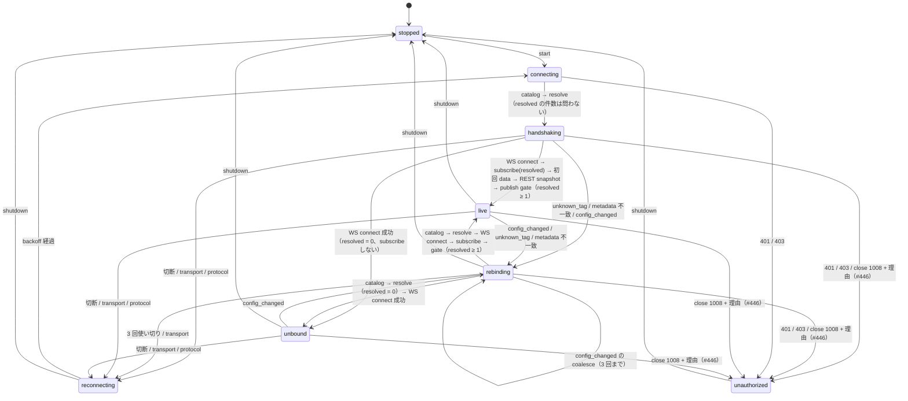

# banto-tagclient 部分 Binding 解決と同一世代 snapshot の設計（#682）

作成日: 2026-10-31
状態: **設計（Issue #682）。実装は未着手。** 実装は本書 §12 の 3 つの PR（同一世代 snapshot →
部分解決 → 全件未解決時の再解決経路）に分けて進める（2026-10-31 オーナー了承の進め方。会話での了承で、
Issue には未記録）。§15 判断 1（strict ポリシーを作らない）・判断 2（全件未解決は新状態 `Unbound`）は
2026-10-31 オーナー決定で本書の立場を採用した。判断 3 は未決。
main へのマージは S7（2026-11-02〜11-08）の後。本書は
[banto-tagclient-design.md](banto-tagclient-design.md) の §3.1・§3.2・§4・§5 を**上書きする差分**であり、
本書に書いていないことは同書が正。実装が入ったら同書の該当節を本書に合わせて直し、本書の
`状態:` 行を更新する。
設計時参照 baseline: `b2d3e75c`（2026-10-31 の main）。

---

## 0. 目的と範囲

SCADA の読み取り Host（[scada-design.md](scada-design.md) §8.4「一部 Object の不成立が他の正常
Object の描画を止めない」）を、`banto-tagclient` の **1 つの `TagClientHandle`** で薄く作れるように、
SDK の購読契約を 2 点拡張する。

1. **部分 Binding 解決**: 要求した外部名のうち catalog に無いものがあっても、ある名前だけで購読を
   成立させ、無い名前は個別の診断として公開する。追加・削除・rename・`config_changed`・Hub
   再起動後の再解決も SDK が所有する。
2. **同一世代の snapshot**: その世代の catalog・Binding 解決結果・current 値を、1 つの状態更新で
   取れるようにする（`Arc` で clone を避ける）。

範囲外（Issue と同じ）: 認証・ユーザー管理、PLC 書き込み（`write_tag` は触らない）、SCADA の
Tauri Host。要求集合（`Vec<BindingRequest>`）の**動的な追加・削除 API** も範囲外とする。
`restart` は `RestClient` だけを差し替え、要求集合は旧 handle のものをそのまま引き継ぐ（`handle.rs`
L138 `restart`）ので、**要求集合を入れ替える手段は `shutdown()` → `RestClient::start(new_requests)`**
とする（2026-10-31 設計判断、Codex の指摘による。§15 未決 1）。

---

## 1. 現状の作り（コード参照、baseline `b2d3e75c`）

| 場所                                                                               | 作り                                                                                                                                                                                                                                                                                                      |
| ---------------------------------------------------------------------------------- | --------------------------------------------------------------------------------------------------------------------------------------------------------------------------------------------------------------------------------------------------------------------------------------------------------- |
| `crates/banto-tagclient/src/binding.rs` `resolve_bindings`（L59〜L99）             | 要求 `binding_key` 重複・要求外部名重複・catalog 外部名重複は `Err`（fail-closed）。catalog に無い名前は `Err` ではなく `BindingResolution::unresolved` に入れて返す。**関数そのものは部分解決に対応済み。**                                                                                              |
| `src/worker.rs` `run_generation_inner`（L356〜L446）                               | `requests.is_empty()` → `InvalidTagSelection`。catalog 取得 → `resolve_bindings` → **`unresolved` が 1 件でもあれば `BindingUnresolved` を返す（L374〜L376）**。以後 `resolved` の外部名だけで `PublishGate` を作り WS subscribe・REST。                                                                  |
| `src/worker.rs` `is_rebindable`（L270）/ `plan_failure`（L145）/ `RebindTracker`   | `BindingUnresolved` は `RevisionMismatch`・`RuntimeMetadataMismatch` と同じ rebindable。catalog からの再試行を **3 回**（`MAX_ADDITIONAL_ATTEMPTS`）繰り返し、使い切ると `FailurePlan::Backoff` → `Reconnecting` で指数 backoff。                                                                         |
| `src/worker.rs` `run_supervisor_with_config`（L188〜L268）                         | 状態の publish はここと `run_attempt`（L286）・`publish_snapshot`（L448）の 3 か所。rebindable な失敗は `TagClientState::rebinding(kind)` を publish してから `plan_failure`。                                                                                                                            |
| `src/stream_core.rs` `PublishGate::finalize`（L266〜）                             | catalog と REST snapshot の `revision`・`run_id`・`collection_mode` の一致、`collection_mode` 既知、REST の値集合が `allowed_tags` と**完全一致**（件数も）することを要求し、1 つの `ValuesSnapshot` を返す。                                                                                             |
| `src/types.rs` `TagClientState`（L292〜L374）                                      | `state` / `current: Option<ValuesSnapshot>` / `last_error`。`transition` は Live 以外で `current` を消す。`publish` は Live にして `current` を置く。**catalog と解決結果は持たない。**                                                                                                                   |
| `src/handle.rs` `TagClientHandle::state` / `state_watch`（L101〜L108）             | `watch::Receiver<TagClientState>` の latest-only。`TagClientState` は `Clone` で `ValuesSnapshot` を丸ごと複製する。                                                                                                                                                                                      |
| `src/rest.rs` `RestClient::start`（L109）                                          | `validate_start_requests`（重複・空・カンマ入りを通信前に拒否）→ `TagClientHandle::spawn`。                                                                                                                                                                                                               |
| `apps/chronogazer/core/src/hub.rs` `plan_bindings`（L568）/ `needs_replan`（L786） | **SDK の外で**catalog を引き、解決できる名前だけを `BindingRequest` にし、残りを `unresolved` / `unsupported` に出す。`Rebinding` や `BindingUnresolved` を見張りで拾って**張り直す**（L824 `needs_rebuild`）。`connection_state_str`（L1477）が `TagClientConnectionState` を `_` 無しで全列挙している。 |
| `apps/banto-hub-sink/src/values.rs` `plan_bindings`（L135）/ `pump_values`（L354） | 同じく SDK の外で catalog を引いて `resolved` だけ渡し、`BindingUnresolved` を見たら `replan` を立てて**バックオフ無しで張り直す**（`run.rs` L545〜）。周期的 replan で同名再作成も拾う。                                                                                                                 |

利用箇所の全列挙（`banto_tagclient` / `banto-tagclient` の grep、2026-10-31）:

- 購読（`start` / `TagClientHandle` を使う）: `apps/chronogazer/core/src/hub.rs`、
  `apps/banto-hub-sink/src/values.rs`（+ `run.rs`、`source/session.rs`）。**2 つとも上の表のとおり
  部分解決を自前で実装している。**
- REST だけ（`fetch_catalog` / `Endpoint` / `ErrorKind`）: `crates/banto-hub-bootstrap`（接続確認）、
  `apps/banto-hub/core`（`value_source.rs`・`rest/sink.rs` は型の共有）、`crates/banto-collect`・
  `crates/banto-tags`（コメントでの参照のみ）。これらは本書の変更を受けない。
- テスト・例: `apps/chronogazer/core/examples/hub_real_smoke.rs`、`tests/hub_collect_roundtrip.rs`、
  `apps/banto-hub-sink/tests/sidecar.rs`、`e2e/chronogazer-mock-hub.ts`（モック Hub）。

## 2. 問題

1. **1 件の未解決で購読全体が止まる。** `run_generation_inner` L374 が `BindingUnresolved` を返すため、
   存在するタグも `current=None` のまま `Rebinding` → 3 回 → `Reconnecting` の backoff に落ちる。
   Issue の最小再現（catalog に `A` だけ、要求 `A` + 未作成 `B`）がこれ。
   [implementation-checklist.md](implementation-checklist.md) §5「1 件の事故で全体を止めない」に反する。
2. **利用者が部分解決を 2 回実装している。** ChronoGazer と Sink が同じ `plan_bindings`（catalog
   取得 → 分割）と「`BindingUnresolved` を見たら張り直す」見張りを持つ（#383・#385 で 3 回出た指摘の
   出どころ）。SCADA を足すと 3 回目になる。「重複実装は共有ライブラリに寄せる」方針（2026-10-01）
   に合わない。
3. **current に対応する metadata が取れない。** `TagClientState` は `ValuesSnapshot` だけを持つので、
   利用者は catalog（型・単位・小数桁・`writable`・`value_source` の表示情報）と解決結果を**別の
   タイミングで**自分で引くしかなく、`config_changed` を挟むと別世代の catalog と値を組み合わせうる。
4. **`Reconnecting` が 2 つの意味を持つ。** transport の backoff と「要求集合が catalog と食い違った
   まま」が同じ状態名に載り、利用者が `last_error` の分類まで見ないと区別できない（checklist §5）。
   部分解決にすると後者が消え、`Reconnecting` は transport の意味だけになる。

## 3. 方針（2026-10-31 設計判断）

| #   | 決定                                                                                                                                                                                                                  | 理由                                                                                                                                                                                                                                                                                                        |
| --- | --------------------------------------------------------------------------------------------------------------------------------------------------------------------------------------------------------------------- | ----------------------------------------------------------------------------------------------------------------------------------------------------------------------------------------------------------------------------------------------------------------------------------------------------------- |
| D1  | **部分解決を SDK の唯一の振る舞いにする**。「全件解決できなければ失敗」の strict ポリシーは**用意しない**（ポリシー enum を作らない）。                                                                               | リポジトリ内の購読利用者 2 つはどちらも strict を望んでおらず、strict を回避するコードを持っている（§1）。選べる口を作ると、使われない分岐を永久にテストし続けることになる。破壊的変更はしてよい（2026-10-17 オーナー方針）。**2026-10-31 オーナー決定（§15 判断 1）**。                                    |
| D2  | 重複（要求 `binding_key`・要求外部名・catalog 外部名）と、購読プロトコルに載らない綴り（空・空白のみ・カンマ）は**従来どおり全体の失敗**。部分成功として扱わない。                                                    | Issue の受入条件 7。重複は「どちらの要求の値か」が決まらないので、1 件でも曖昧さを残すと値の誤表示になる。綴りは `start()` の通信前検証（`validate_start_requests`）で既に落としており、利用者は純関数で事前に除ける（ChronoGazer の `unsupported`、Sink の同名関数）。                                     |
| D3  | **全件未解決は失敗ではなく、新しい接続状態 `Unbound`**。WS は張るが `subscribe` は送らず、`config_changed` を待って再解決する。                                                                                       | 空の `subscribe` は Hub が拒否する（`stream.rs` の `invalid_request`）。Hub は `config_changed` を**購読の有無に関係なく全 WS 接続へ**送る（`apps/banto-hub/core/src/stream.rs` L595 `revision_rx.changed()`）ので、ポーリングせずに「タグが作られた」を知れる。**2026-10-31 オーナー決定（§15 判断 2）**。 |
| D4  | 同一世代の catalog・解決結果・値を **1 つの `Arc<GenerationSnapshot>`** として `TagClientState` に載せ、`Live` と `Unbound` で公開する。`current()` の返り型は変えない（`Option<&ValuesSnapshot>`）。                 | 利用者の既存コードを壊さず、新しい口（`snapshot()`）を足すだけで metadata が取れる。`watch` は latest-only なので「同じ更新」は 1 つの値に同梱するしかない。                                                                                                                                                |
| D5  | **世代番号 `generation: u64`** を SDK が振り、snapshot に載せる。catalog の取得に成功した試行ごとに +1。                                                                                                              | `revision` は Hub の構成世代、`run_id` は収集の実行世代で、どちらも「SDK が張り直した」ことを表さない（同じ revision で切断 → 再接続がある）。利用者がタグごとのキャッシュを捨てる鍵が要る。                                                                                                                |
| D6  | 再解決のトリガは**既存のまま**（`config_changed`・`unknown_tag`・metadata 不一致・切断後の再接続）。部分解決に伴う新しいトリガは足さない。要求集合の変更は `shutdown()` → `start(new_requests)` で入れ替える（§0）。  | 「削除・rename」は Hub が `config_changed` を送るので既存経路で捕まる。「未作成タグが作られた」も同じ。SDK 側の周期ポーリングは無駄撃ち（checklist §5「変わりようのない安定状態で外部を叩かない」）。                                                                                                       |
| D7  | 利用者（ChronoGazer・Sink）は**別 PR で追従**し、自前の catalog 取得・分割・`BindingUnresolved` 見張りを**消す**。SDK の 3 PR の中では、PR-3 の ChronoGazer `connection_state_str` の列挙 1 行以外は触らない（§10）。 | 2 つの利用者は「解決できる名前だけ渡す」ので、SDK が部分解決になっても挙動は変わらない（渡した名前は全部 catalog にある）。追従は SDK 完了後に 1 利用者 1 PR で小さく。**オーナー判断待ち（§15 判断 3）**。                                                                                                 |

## 4. 公開 API の具体形

### 4.1 型（`types.rs` / `binding.rs`）

```rust
/// 接続状態。`Unbound` を足す（§7）。
pub enum TagClientConnectionState {
	Stopped,
	Connecting,
	Handshaking,
	Live,
	/// 要求が全件 catalog に無い。WS は張っているが購読は無く、値も無い。
	/// `config_changed` を受けると `Rebinding` へ進む。
	Unbound,
	Rebinding,
	Reconnecting,
	Unauthorized,
}
// Display: "unbound"

/// 1 つの SDK 世代で一致した catalog・解決結果・値。`Live` と `Unbound` で公開される。
#[derive(Clone, Debug, PartialEq)]
pub struct GenerationSnapshot {
	/// SDK が振る世代番号（§6）。catalog を取れた試行ごとに +1。同じ handle 内で単調増加。
	pub generation: u64,
	/// この世代が解決に使った catalog。`values` と同じ `revision` / `run_id` / `collection_mode`。
	pub catalog: Arc<CatalogSnapshot>,
	/// この catalog に対する全要求の解決結果。`resolved` + `unresolved` = 要求の全件。
	pub resolution: Arc<BindingResolution>,
	/// `Live` のときだけ `Some`。`Unbound`（`resolution.resolved` が空）では `None`。
	pub values: Option<Arc<ValuesSnapshot>>,
}

impl GenerationSnapshot {
	pub fn revision(&self) -> u64;                       // catalog.revision（values があれば等しい）
	pub fn run_id(&self) -> Option<u64>;
	pub fn collection_mode(&self) -> &CollectionMode;
	/// binding_key から、解決済みなら catalog 行と値（`Live` のとき）を引く。
	pub fn binding(&self, binding_key: &str) -> Option<BindingView<'_>>;
}

/// 1 つの binding_key の、この世代での見え方。
pub enum BindingView<'a> {
	Resolved {
		binding: &'a ResolvedBinding,
		tag: &'a CatalogTag,
		/// `Live` では必ず `Some`（§6 規則 R4）。`Unbound` では到達しない（resolved が空）。
		value: Option<&'a ValueEntry>,
	},
	Unresolved(&'a UnresolvedBinding),
}

/// 公開状態。`snapshot` を足す。`current` は `snapshot.values` の別名。
pub struct TagClientState {
	state: TagClientConnectionState,
	snapshot: Option<Arc<GenerationSnapshot>>,
	last_error: Option<ErrorKind>,
}

impl TagClientState {
	pub const fn connection_state(&self) -> TagClientConnectionState;
	/// `Live` または `Unbound` のときだけ `Some`。
	pub fn snapshot(&self) -> Option<&Arc<GenerationSnapshot>>;
	/// 従来どおり `Live` のときだけ `Some`（= `snapshot().and_then(|s| s.values.as_deref())`）。
	pub fn current(&self) -> Option<&ValuesSnapshot>;
	pub const fn last_error(&self) -> Option<ErrorKind>;
}
```

`BindingResolution` / `ResolvedBinding` / `UnresolvedBinding` / `resolve_bindings` は現状のまま
（§1 のとおり既に部分解決を返す）。`UnresolvedBinding` に理由を足す（§6.2）:

```rust
pub struct UnresolvedBinding {
	pub binding_key: String,
	pub external_name: String,
	/// なぜ解決できないか。現状は 1 種類だが、`Unknown` を今から持たせて fail-closed を保つ。
	pub reason: UnresolvedReason,
}

#[non_exhaustive]
pub enum UnresolvedReason {
	/// catalog にこの外部名が無い（未作成・削除・rename 後の旧名）。
	NotInCatalog,
}
```

### 4.2 Handle・`RestClient`（変更なし）

```rust
impl RestClient {
	pub fn start(self, requests: Vec<BindingRequest>) -> Result<TagClientHandle>; // 変更なし
}
impl TagClientHandle {
	pub fn state(&self) -> TagClientState;                                 // 変更なし
	pub fn state_watch(&self) -> watch::Receiver<TagClientState>;          // 変更なし
	pub async fn shutdown(self) -> Result<()>;                             // 変更なし
	pub async fn restart(self, replacement: RestClient) -> Result<TagClientHandle>; // 変更なし
}
```

`start` の通信前検証（空の要求・重複・カンマ入り）は変えない（D2）。

### 4.3 エラー分類（`error.rs`）

| 分類                     | 変更                                                                                                                                                                                                                                                                                                                                                                                                                                      |
| ------------------------ | ----------------------------------------------------------------------------------------------------------------------------------------------------------------------------------------------------------------------------------------------------------------------------------------------------------------------------------------------------------------------------------------------------------------------------------------- |
| `binding_unresolved`     | **PR-3 の後は worker が解決結果から返すことはなくなる**。残る発生源は WS の `{"op":"error","code":"unknown_tag"}`（`stream_core.rs` `parse_hub_wire` L102〜）だけ: catalog 取得と subscribe の間に Hub 側でタグが消えた競合。rebindable のまま（catalog から再解決すれば `unresolved` に移る）。**暫定（PR-2 から PR-3 まで）**: `resolved` が空のときだけ worker からも返る（§12 PR-2）。この間は `error.rs` の doc に暫定の注記を置く。 |
| `invalid_tag_selection`  | 変更なし（空の要求集合・カンマ入りは全体の失敗）。                                                                                                                                                                                                                                                                                                                                                                                        |
| `duplicate_*` の 3 分類  | 変更なし（全体の失敗、terminal）。                                                                                                                                                                                                                                                                                                                                                                                                        |
| `revision_mismatch` ほか | 変更なし。                                                                                                                                                                                                                                                                                                                                                                                                                                |

## 5. 状態機械



現状（banto-tagclient-design.md §5）との差は、`unbound` の追加と、`handshaking`/`rebinding` が
「WS を張った後に resolved 件数で `live` 系と `unbound` に分岐する」ことだけ。`Handshaking` は現状
どおり `Connecting` モードのときだけ `connect_stream()` の前に publish する（`worker.rs` L383〜L385）ので、
`Rebinding` モードからは `handshaking` を経ずに `live` / `unbound` へ進む。`Reconnecting` は
transport 系の backoff だけを表すようになる（§2 の問題 4 が消える）。

### 5.1 `run_generation_inner` の変更点（擬似コード）

```text
requests が空            → InvalidTagSelection（現状どおり、start() で先に落ちる）
catalog = fetch_catalog() (stop 割り込み可)
resolution = resolve_bindings(requests, catalog.tags)?   // 重複は Err → terminal
generation = generation_counter.fetch_add(1) + 1          // handle の Arc<AtomicU64>（§6 R2）
if mode == Connecting: publish Handshaking               // 現状どおり（L383〜L385）。Rebinding モードでは Rebinding のまま
connection = connect_stream() (stop 割り込み可)           // 401/403 → Unauthorized、transport → Reconnecting は現状どおり
if resolution.resolved が空:
    publish TagClientState { state: Unbound, snapshot: Some({generation, catalog, resolution, values: None}) }
                                                          // WS が張れた後にだけ publish する（§4.1 doc「WS は張っている」と一致）
    recheck = fetch_catalog() (stop 割り込み可)             // WS 確立後に catalog を取り直す（下の段落）
    if recheck.revision != catalog.revision → Err(RevisionMismatch)   // その間にタグが作られた等 → rebindable 経路
    reached_unbound = true                                // RebindTracker だけをリセットする印（§7）
    loop: receive_text() (stop 割り込み可)
        config_changed → Err(RevisionMismatch)            // 既存の rebindable 経路に乗せる
        data/ignored  → 無視（購読していないので data は来ない。来たら ProtocolError）
        切断/transport → Err(Transport)                    // 既存の retryable 経路
else:
    tags = resolution.resolved の external_name
    gate = PublishGate::new(subscription_id, tags)
    （以下は現状どおり: subscribe → 初回 data → REST → finalize → publish）
    publish_snapshot は TagClientState { state: Live, snapshot: Some({generation, catalog, resolution, values: Some(..)}) }
```

`connect_stream()` を `if` の外に出すのは、`Unbound` を「WS は張っているが購読が無い」状態として
publish するため（§5 の `handshaking --> unbound` / `rebinding --> unbound` は WS connect **成功**で遷移）。
WS が張れなければ `Unbound` には入らず、現状どおり `Reconnecting` / `Unauthorized` へ進む。

**WS 確立後の catalog の取り直し（2026-10-31 設計判断、Codex の指摘による）**: Hub の WS は接続を
始めた時点で `revision_rx` を作り（`stream.rs` `handle_socket`）、それより前の変更は再送しない
（`hub.rs` `subscribe_revision`）。`fetch_catalog()` と WS 確立の間に要求したタグが作られると、
`Unbound` のまま次の設定変更か切断まで待ち続けてしまう。解決済みの側は初回 data の後の REST
（`finalize` の revision 一致）でこの窓を閉じているが、`Unbound` 側にはそれが無い。そこで WS
確立の**後に** catalog を取り直し、revision が最初の catalog と違えば `RevisionMismatch` として
rebindable 経路に乗せる。revision が同じなら、それ以降の変更は WS の `config_changed` で必ず届く。
PR-3 のテストに「`fetch_catalog()` と WS 確立の間にタグを作る」を入れる（§13）。

`Unbound` で受けた `config_changed` を `RevisionMismatch` として返すのは、`plan_failure` の
rebindable 経路（3 回の高速再試行 → backoff）をそのまま使うため。`last_error` には
`RevisionMismatch` ではなく **`ConfigChanged` が無いので `RevisionMismatch`** が載る。
これは Live 中の `config_changed` と同じ扱い（`PublishGate::accept_wire` L190、`ConfigChanged` の処理は
L206〜）で、分類を増やさない。

## 6. 世代と snapshot の整合規則

- **R1（同一世代）**: `GenerationSnapshot` の `catalog`・`resolution`・`values` は同じ試行で得たもの。
  `values` があるとき `values.revision == catalog.revision`、`values.run_id == catalog.run_id`、
  `values.collection_mode == catalog.collection_mode`（`PublishGate::finalize` が既に保証）。
- **R2（generation の単調増加）**: 同じ `TagClientHandle` の `state_watch` で観測される `generation`
  は単調に増える。`restart` で返る新 handle は **1 から数え直さず、旧 handle の値を引き継ぐ**
  （利用者が旧 handle の値と比べられるように）。**置き場は 1 つ**: `TagClientHandle` が
  `generation: Arc<AtomicU64>` を持ち、`spawn` / `restart` が worker（`run_supervisor_with_config`）に
  引数で渡す。worker は catalog を取れた試行ごとに `fetch_add(1)` する。gate で失敗した試行でも進むので、
  利用者が観測する値は「+1」ではなく「前より大きい」だけが保証される。
- **R3（旧世代の値を混ぜない）**: `Live` 以外へ遷移したとき `snapshot` は `None`（`Unbound` だけは
  `values: None` の snapshot を持つ）。`config_changed` → `Rebinding` の瞬間に旧 `values` は消える。
  Hub 再起動は切断 → `Reconnecting` で消え、再接続は catalog から取り直す。`run_id` が変わった
  REST snapshot は `finalize` で `RuntimeMetadataMismatch` になる（現状どおり）。
- **R4（Live の完全性）**: `Live` の `values.values` は `resolution.resolved` の外部名と**完全一致**
  （`finalize` の件数一致チェック）。`BindingView::Resolved.value` は `Live` で必ず `Some`。
- **R5（Unbound の完全性）**: `Unbound` では `resolution.resolved` が空、`resolution.unresolved` が
  要求の全件、`values` が `None`。
- **R6（`Arc`）**: `TagClientState::clone()` は `Arc` の参照カウントだけを増やす。catalog が数千行
  でも `state_watch` の `borrow_and_update().clone()` は O(1)。`GenerationSnapshot` の中の 3 つも
  それぞれ `Arc` にして、利用者が catalog だけを長く持てるようにする。
- **R7（`value_source` と `simulation`）**: 値側 `ValueEntry.value_source` を authoritative とし、
  `CatalogTag.value_source` / `effective_simulation` で上書きしない（banto-tagclient-design.md §3.2
  のまま）。`BindingView::Resolved` が両方を返すのは、表示が catalog の情報ラベルを使うため。

### 6.1 利用者の読み方（SCADA Host の想定）

```rust
let state = rx.borrow_and_update().clone();      // Arc clone だけ
match (state.connection_state(), state.snapshot()) {
	(Live, Some(snap)) => for key in project.binding_keys() {
		match snap.binding(key) {
			Some(BindingView::Resolved { value: Some(v), tag, .. }) => draw(key, v, tag),
			Some(BindingView::Unresolved(u)) => draw_unresolved(key, &u.reason),
			_ => unreachable!("R4"),
		}
	},
	(Unbound, Some(snap)) => all_unresolved(snap),
	(other, None) => degraded(other, state.last_error()),
	_ => unreachable!("snapshot は Live/Unbound だけ"),
}
```

### 6.2 `unresolved` の理由

現状の未解決は「catalog に無い」の 1 種類だけ（未作成・削除・rename 後の旧名は区別できない。
tag-server-design.md §4.1「リネームは破壊的変更」）。`UnresolvedReason` を今から enum にするのは、
後で「権限で見えない」（Hub がスコープで catalog を絞る場合）などを足すときに
`BindingView` の形を変えないため。**類似名への自動割り当ては行わない**（受入条件 3。
scada-design.md §9.6 案 C「改名候補の提示」は保留のまま）。

## 7. 全件未解決（`Unbound`）の規則

- **空 `subscribe` を送らない**（受入条件 4）。WS は張る（認証・close 1008 の検出は Live と同じ）。
- **値は無い**: `current() == None`、`snapshot().values == None`。
- **再解決の経路**: `config_changed` を受けたら `Rebinding`（§5.1）。切断なら `Reconnecting` →
  backoff → catalog から。`shutdown` / `restart` はどの瞬間でも効く（`stop` の `select!` 割り込みは
  現状の受信ループと同じ形）。
- **budget を消費しない**: `Unbound` 自体は失敗ではないので `RetryTracker` / `RebindTracker` を
  進めない。`Unbound` で受けた `config_changed` は Live と同じ rebindable 扱い。
- **2 つの tracker のリセット（2026-10-31 設計判断）**: `Unbound` 到達では **`RebindTracker` だけ**を
  リセットし、**`RetryTracker`（`delay_after_failure` の `was_live`）のリセットは従来どおり `Live` で
  data を受けてから**（`publish_snapshot` L458）に限る。
  - `RebindTracker` をリセットする理由: `Unbound` → `config_changed` → `Rebinding` → また `Unbound`
    が繰り返されると、`next_rebind_mode`（L90）は `was_live` が立たず `mode` も `Rebinding` のままなので
    3 回の budget を使い切って `Reconnecting` の backoff に落ちる。`Unbound` は「世代を確立した」状態
    なので、ここで rebind の budget は新しくする。
  - `RetryTracker` をリセットしない理由: WS は張れても、無購読の接続をすぐ閉じる相手（Hub の将来の
    作り、または経路上の proxy）だと「connect 成功 → `Unbound` → 切断 → `Reconnecting`」が回り、
    `Unbound` で backoff をリセットすると **1 秒固定の再接続ループ**になる。`Live` で data を受けるまで
    backoff を伸ばし続ければ、この相手でも暴走しない（§15 未決 4）。
  - 実装: `was_live` の意味は変えず、`Unbound` 到達で立てる別の印（`reached_unbound`）を
    `AttemptFailure` に足し、`next_rebind_mode` の条件を `was_live || reached_unbound || mode != Rebinding`
    にする。`delay_after_failure` には `was_live` だけを渡す。
- **Hub 側の無購読接続**: Hub の WS ループは購読 0 件でも `revision_rx` を待ち、`config_changed`
  を送る（`stream.rs` L595）。無購読接続を Hub が時間で閉じる作りは見つからなかったが、**PR-3 の
  実機確認で「購読 0 件の WS を 10 分以上保って `config_changed` が届く」を 1 回確かめる**
  （§13）。閉じられる場合は `Reconnecting` → 再接続で戻るので値の誤表示にはならず、`RetryTracker`
  を `Unbound` でリセットしない（上）ので再接続の間隔は指数で伸びる。

## 8. 部分解決の規則

- **P1**: 要求集合は handle が**全件保持**する（現状どおり `TagClientHandle.requests`）。解決は
  試行ごとに catalog 全体に対して行い、結果の `resolved + unresolved` は常に要求の全件。
- **P2**: 購読（WS `subscribe` と REST `?tags=`）は `resolved` の外部名だけ。`PublishGate` の
  `allowed_tags` も `resolved` だけ。
- **P3（全体の失敗、D2）**: `DuplicateBindingKey` / `DuplicateRequestedExternalName` /
  `DuplicateCatalogExternalName` は `Err` → terminal（現状どおり `plan_failure` で
  `FailurePlan::Terminal`）。`InvalidTagSelection` は `start()` で通信前に `Err`。
- **P4（不一致の優先順位）**: catalog 外部名重複は Hub 側の不整合で、利用者の要求では直せないので
  terminal にする。ただし `Stopped` + `last_error = DuplicateCatalogExternalName` で止まるだけだと
  Hub を直した後に `restart` が要る。これは現状と同じで、本書では変えない（§15 未決 3）。
- **P5（削除・rename）**: 購読中の削除・rename は Hub の `config_changed` → `Rebinding` → 再解決で
  その名前が `unresolved` に移り、残りは `Live` に戻る。`unknown_tag` で subscribe が拒否された
  場合（catalog 取得と subscribe の間の競合）も同じ経路。
- **P6（追加）**: 未作成だった名前が作られると `config_changed` → 再解決で `resolved` に移る。
  `Unbound` からは `Live` へ。
- **P7（空の要求）**: `start(vec![])` は従来どおり `InvalidTagSelection`。「購読するものが無い」は
  利用者が handle を作らないことで表す（Sink の `Subscription::start` が既にそうしている）。

## 9. current の無効化

現状の規則（`TagClientState::transition` が Live 以外で `current` を消す）を `snapshot` にも
そのまま適用する。

| 事象                                        | 遷移                             | `snapshot`               | `current` |
| ------------------------------------------- | -------------------------------- | ------------------------ | --------- |
| `config_changed`（Live / Unbound）          | → `Rebinding`                    | `None`                   | `None`    |
| `unknown_tag` / metadata 不一致             | → `Rebinding`                    | `None`                   | `None`    |
| 切断・transport・protocol・catalog 取得不能 | → `Reconnecting`                 | `None`                   | `None`    |
| 401/403・close 1008（#446）                 | → `Unauthorized`（再接続しない） | `None`                   | `None`    |
| `shutdown` / `restart`（旧 handle）         | → `Stopped`                      | `None`                   | `None`    |
| 全件未解決で世代確立                        | → `Unbound`                      | `Some`（`values: None`） | `None`    |
| 1 件以上解決で gate 通過                    | → `Live`                         | `Some`（`values: Some`） | `Some`    |

shutdown / restart / backoff の保証（banto-tagclient-design.md §4・§5・§6）は変えない。
`Unbound` の受信ループにも `stop` の `biased` な `select!` を置き、`close_best_effort` してから
`Stopped` を返す。

## 10. 既存利用者の移行（D1・D7）

| 利用者                                         | 今                                                                                                                                                                                           | SDK の 3 PR の後にすること（別 PR、1 利用者 1 PR）                                                                                                                                                                                                                                                                                                                                                                                                       |
| ---------------------------------------------- | -------------------------------------------------------------------------------------------------------------------------------------------------------------------------------------------- | -------------------------------------------------------------------------------------------------------------------------------------------------------------------------------------------------------------------------------------------------------------------------------------------------------------------------------------------------------------------------------------------------------------------------------------------------------- |
| ChronoGazer `apps/chronogazer/core/src/hub.rs` | `plan_bindings` で catalog を引いて `resolved` だけ `start`。`unresolved` / `unsupported` を `HubSubscriptionView` に出す。見張りが `Rebinding` / `BindingUnresolved` を張り直し対象にする。 | 選択タグを**全件** `start` に渡す（`unsupported` の綴り除外は純関数のまま残す）。`unresolved` は `snapshot().resolution.unresolved` から出す。`needs_replan` から `BindingUnresolved` を外し、`Rebinding` を `needs_rebuild` から外す（SDK が自力で戻る）。`Unbound` を「購読は張れているが全部無い」として表示に足す。`Fingerprint` の catalog 依存を外す（選択タグの変化による張り直し＝`shutdown` → `start(new_requests)` は残す、§0）。              |
| Sink `apps/banto-hub-sink/src/values.rs`       | 同上 + `replan` で即時張り直し + 周期 replan。                                                                                                                                               | `plan_subscription` の catalog 取得・`replan`・周期 replan を消す。`unresolved` は snapshot から。`Unbound` を `ValueView { live: false }` に写す。`run.rs` `ensure_subscription` の作り直す条件のうち、`needs_replan`（SDK の解決失敗）と周期 replan（`periodic_due`）だけを消す。**`changed`（設定変更で要求集合が変わった）は残し**、従来どおり `shutdown` → `start(new_requests)` で入れ替える（SDK は要求集合を変えない、§0。Codex の指摘による）。 |
| SCADA Host（新規、別 Issue）                   | -                                                                                                                                                                                            | §6.1 の形で 1 Project = 1 handle。                                                                                                                                                                                                                                                                                                                                                                                                                       |

SDK の 3 PR の間、2 つの利用者は**挙動が変わらない**: 渡す名前は全部 catalog にあるので
`unresolved` は空、`Unbound` にも入らない。ただし compile は **ChronoGazer だけ通らない**:
`apps/chronogazer/core/src/hub.rs` `connection_state_str`（L1477）が `TagClientConnectionState` を
`_` 無しで全列挙しているので、PR-3 で `Unbound` を足すと `non-exhaustive patterns` になる。
PR-3 の範囲に **`connection_state_str` に `Unbound => "unbound"` を 1 行足す**ことを含める
（表示文字列は SDK の `Display` と同じ）。Sink は `Stopped` との比較だけ（`values.rs` L364）なので
そのまま通る。PR-1・PR-2 は利用者に触らない。

## 11. 受入条件との対応

| #   | 受入条件（Issue #682）                                                                                       | 本書                          | 実装 PR                                            |
| --- | ------------------------------------------------------------------------------------------------------------ | ----------------------------- | -------------------------------------------------- |
| 1   | 正常タグと未解決タグが混在しても正常タグの current が取れる                                                  | §5.1・§8 P1〜P2               | PR-2                                               |
| 2   | 未作成タグの追加後に SDK が再解決し、正常タグの監視も継続する                                                | §8 P6・D6                     | PR-2（Live から）/ PR-3（Unbound から）            |
| 3   | 削除・rename 後はその名前を unresolved とし、類似名へ自動割り当てせず、他の正常表示を止めない                | §8 P5・§6.2                   | PR-2                                               |
| 4   | 全件未解決のときは空 subscribe を送らず、無値の状態と停止可能な再解決経路を定義する                          | §7・D3                        | PR-3                                               |
| 5   | catalog / resolution / current の revision・run_id・collection_mode が同一更新で整合。旧値を新世代に混ぜない | §6 R1〜R3・§9                 | PR-1                                               |
| 6   | 切断・再解決・認証拒否で current を直ちに無効化し、shutdown / restart / backoff の保証を保つ                 | §9・§7「budget を消費しない」 | PR-1（snapshot の無効化）/ PR-3（Unbound の stop） |
| 7   | Binding key・要求外部名・catalog 外部名の重複、不正プロトコルを部分成功として許容しない                      | D2・§8 P3                     | PR-2（回帰テスト）                                 |
| 8   | 既存 strict 利用者への回帰と simulation / value_source / Quality の扱いを検証する                            | §10・§6 R7・§13               | PR-1〜PR-3 の各テスト + 利用者の追従 PR            |

## 12. 実装 PR の切り分け（2026-10-31 オーナー了承の順。会話での了承で、Issue には未記録）

各 PR は原則 `crates/banto-tagclient` だけを触る。例外は PR-3 の ChronoGazer `connection_state_str`
の列挙 1 行だけ（§10。利用者の追従そのものは別 PR）。モデルは sonnet、レビューは上位。
各 PR の最後に `cargo test -p banto-tagclient` を 1 回（PR-3 は `-p chronogazer-core` の compile も）。

### PR-1: 同一世代 snapshot（`GenerationSnapshot`）

- 範囲: `types.rs` に `GenerationSnapshot` / `BindingView` / `TagClientState::snapshot()`。
  `TagClientState` の内部を `current: Option<ValuesSnapshot>` → `snapshot: Option<Arc<GenerationSnapshot>>`
  に置き換え、`current()` は別名として残す。`worker.rs` の `publish_snapshot` が catalog と
  resolution を `Arc` にして載せる。`generation` カウンタは `TagClientHandle` の `Arc<AtomicU64>` に置き、
  `spawn` / `restart` が `run_supervisor_with_config` に引数で渡す（R2）。`binding.rs` の
  `UnresolvedBinding.reason` と `UnresolvedReason`。
  `lib.rs` の re-export と冒頭 doc。
- **振る舞いは変えない**: `unresolved` が 1 件でもあれば `BindingUnresolved`（L374）のまま。
  `Unbound` は足さない。
- 完了条件: 既存テスト全緑。新規テスト = R1（`values` と `catalog` の 3 つの metadata が一致）、
  R2（`config_changed` 再 bind で `generation` が単調に増える（gate で失敗した試行でも進むので +1 以上）、
  `restart` 後も続く）、R3（`Rebinding` /
  `Reconnecting` / `Unauthorized` / `Stopped` で `snapshot() == None`）、R4（`binding(key)` が
  `Live` で `value: Some`）、R6（`TagClientState::clone` 後に `Arc::ptr_eq`）。
  `all_public_states_and_non_live_transitions_clear_current`（`stream_core.rs` L715）を snapshot にも広げる。
- 利用者への影響: なし（追加だけ。`current()` の型は同じ）。

### PR-2: 部分解決（既定を変える）

- 範囲: `run_generation_inner` の L374〜L376 を外し、`resolved` だけで `PublishGate` を作る。
  `resolved` が空のときは**暫定で** `BindingUnresolved` を返す（PR-3 で `Unbound` に置き換える。
  つまり PR-2 の時点では「全件未解決」だけが従来どおり rebind → backoff）。`is_rebindable` の
  `BindingUnresolved` は残す（`unknown_tag` 用）。`error.rs` の `BindingUnresolved` の doc を §4.3 に直し、
  「PR-3 までは `resolved` が空のときだけ worker からも返る」の暫定の注記を足す（PR-3 で外す）。
  利用者（ChronoGazer / Sink）には触らない。
- 完了条件: 受入 1・2（Live から）・3・7 のテスト。具体的には
  - 混在（`A` あり + `B` 無し）で `Live`、`values` は `A` だけ、`resolution.unresolved == [B]`。
  - Live 中に `config_changed` で `B` が作られる → 再 bind 後 `resolved == [A, B]`、`generation` +1。
  - Live 中に `config_changed` で `A` が rename → 再 bind 後 `unresolved == [A]`、`B` の値は出続ける。
    類似名（`A2`）があっても割り当てない。
  - 重複 3 分類は `Stopped` + `last_error`（現状の `every_duplicate_class_fails_before_partial_result_is_returned` を worker 経由にも）。
  - REST `?tags=` と WS `subscribe` に `B` が**含まれない**（モック Hub で受けた要求を assert）。
  - 既存の `unresolved_catalog_rebinds_and_recovers_once_the_name_exists`（L1244）と
    `rename_leaves_the_old_name_unresolved_until_the_same_name_is_recreated`（L1322）は、要求が
    1 件なので「全件未解決」になり PR-2 では従来どおり通る。PR-3 で `Unbound` 版に書き換える。
- 利用者への影響: 挙動の差なし（§10）。

### PR-3: 全件未解決（`Unbound`）と再解決経路

- 範囲: `TagClientConnectionState::Unbound`、§5.1 の `Unbound` 分岐（WS connect 成功の後に publish・
  subscribe なし・WS 確立後の catalog の取り直し・`config_changed` 待ち・stop 割り込み）、`reached_unbound` による `RebindTracker` だけの
  リセット（§7。`was_live` / `RetryTracker` は変えない）、`Display`。PR-2 の暫定 `BindingUnresolved`
  と `error.rs` の暫定の注記を外す。**ChronoGazer `apps/chronogazer/core/src/hub.rs`
  `connection_state_str`（L1477）に `Unbound => "unbound"` を 1 行足す**（§10。足さないと
  `chronogazer-core` の compile が通らない）。banto-tagclient-design.md §4 の分類表・§5 の状態図を
  本書に合わせて直し、本書の `状態:` を「実装済み」に。
- 完了条件: 受入 4・2（Unbound から）・6 のテスト。
  - 全件未解決 → `Unbound`、`snapshot().values == None`、`resolution.unresolved` が全件、モック Hub
    が `subscribe` を**受けていない**。
  - `Unbound` 中に `config_changed` → `Rebinding` → タグが作られていれば `Live`。
  - 最初の `fetch_catalog()` と WS 確立の間にタグを作る（モック Hub が 2 回目の catalog で revision を
    進める）→ `Unbound` に留まらず `Rebinding` → `Live`（§5.1 の取り直し）。
  - `Unbound` → `config_changed` → `Unbound` を 4 回繰り返しても `Reconnecting` に落ちない（rebind の
    budget が `Unbound` で新しくなる。`live_rebind_success_starts_a_new_rebind_budget` L767 の `Unbound` 版）。
  - `Unbound` 中の切断 → `Reconnecting` → backoff → 再接続で `Unbound` に戻る。**backoff の遅延は
    `Unbound` ではリセットされず**、切断が続けば指数で伸びる（§7 の設計判断）。
  - `Unbound` 中の `shutdown` が余計な試行なしに `Stopped`（`stop_during_rebinding_catalog_waits_for_no_extra_attempt` L1497 の `Unbound` 版）。
  - `Unbound` 中の close 1008 → `Unauthorized` + 理由（`a_1008_close_stops_with_its_reason_and_does_not_reconnect` L2049 の `Unbound` 版）。
  - PR-2 で残した 2 つのテストを `Unbound` 版に書き換える。
- 実機確認（マージ前、`apps/chronogazer/core/examples/hub_real_smoke.rs` か専用の example）:
  実 Hub に未作成タグだけで接続 → `Unbound` → Hub の UI でタグを作る → `Live` になる。
  購読 0 件の WS を 10 分保って `config_changed` が届く（§7）。
- 利用者への影響: `Unbound` が増える。ChronoGazer は上の 1 行で compile を通す。Sink はそのまま通る（§10）。

### 追従 PR（SDK の後、本書の範囲外だが順序を固定する）

PR-4: ChronoGazer（§10）。PR-5: Sink（§10）。どちらも `plan_bindings` と見張りの縮退が主で、
`docs/banto-hub-client-bootstrap.md`・`docs/banto-hub-sink-design.md`（あれば）の該当節を同じ PR で直す。

## 13. テスト計画

既存の `worker.rs` のモック Hub（`serve_named_generation` ほか、TCP で REST と WS を手書き）を
そのまま使う。新しい足場は要らない。

| 層                 | 内容                                                                                                                                                                                                                                                            | PR   |
| ------------------ | --------------------------------------------------------------------------------------------------------------------------------------------------------------------------------------------------------------------------------------------------------------- | ---- |
| 純関数             | `resolve_bindings`: `reason` が付く。重複 3 分類は変更なし。`GenerationSnapshot::binding` の総当たり（resolved+値あり / resolved+値なし（Unbound）/ unresolved / 未知 key）。                                                                                   | 1    |
| 状態 DTO           | 全状態 × `snapshot` / `current` の有無を表で（§9 の表そのまま）。`Clone` が `Arc::ptr_eq`。                                                                                                                                                                     | 1,3  |
| worker（モック）   | §12 の各 PR の完了条件。加えて: `config_changed` 連打の coalesce が部分解決でも 1 回の rebind になる（`config_changed_burst_rebinds_once_...` L914 を混在要求に）。REST の値集合が `resolved` と食い違えば `ProtocolError`（R4）。                              | 2,3  |
| 値の扱い（受入 8） | 混在要求で `value_source=simulation` / `derived_simulation` の値が `Live` で**そのまま**公開され、`Quality::Bad/Stale` も値側のまま。`CatalogTag.effective_simulation` で上書きされない（R7）。`collection_mode` 不一致は従来どおり `RuntimeMetadataMismatch`。 | 2    |
| 回帰（受入 8）     | ChronoGazer `hub.rs`・Sink `values.rs` の既存テストが SDK の 3 PR の後も緑（CI の workspace テストで自動）。                                                                                                                                                    | 1〜3 |
| 実機               | PR-3 の §12 項目。                                                                                                                                                                                                                                              | 3    |

checklist §5 で先回りするもの: 「自動で再試行します」と書いたら経路があるか（`Unbound` →
`config_changed` の経路をテストで固定）／見張りの「放置してよい状態」を状態名だけで決めない
（`Unbound` は放置してよい状態として利用者に明記）／回帰テストは直した箇所を戻して落ちるか 1 回
確かめる（PR-2 で L374 を戻すと混在テストが落ちること）。

## 14. 設計上の注意（実装者へ）

- `TagClientState` の publish は `run_supervisor_with_config`・`run_attempt`・`publish_snapshot` の
  3 か所に散っている。PR-1 で `TagClientState` のコンストラクタ（`live(snapshot)` / `unbound(snapshot)` /
  `rebinding(kind)` …）を揃え、`snapshot` を `Live`・`Unbound` 以外で `Some` にできない形
  （`pub(crate)` のコンストラクタ以外で `snapshot` を触れない）にする。
- `generation` は **catalog 取得の成功**で進める（gate 通過ではない）。`Unbound` にも番号が要るため。
- `Arc<CatalogSnapshot>` を作るのは試行ごとに 1 回。`PublishGate::finalize(&catalog)` は `&` で
  受けているので `Arc` の中身をそのまま渡せる。
- `BindingResolution` は要求順を保つ（`resolve_bindings` が `requests` の順で push）。SCADA が
  Project の順で描くために順序を変えない。
- `UnresolvedReason` は `#[non_exhaustive]`。利用者の `match` に `_` を強いる。

## 15. 未決事項・オーナー判断待ち

| #      | 事項                                                                                                                                                                                                                                                                                          | 本書の仮の立場                                                                                                                                                                                                          |
| ------ | --------------------------------------------------------------------------------------------------------------------------------------------------------------------------------------------------------------------------------------------------------------------------------------------- | ----------------------------------------------------------------------------------------------------------------------------------------------------------------------------------------------------------------------- |
| 判断 1 | **2026-10-31 オーナー決定: 本書の立場で採用。** **strict ポリシーを用意しない**（D1）。Issue 本文の「既存 strict 利用者への影響がある場合は明示的な解決ポリシー等で互換性を扱う」に対し、リポジトリ内に strict を望む利用者が無いことを根拠に、ポリシー enum を作らず既定を部分解決に変える。 | 作らない。必要が出たら `start_with_policy` を後付けできる形（`start` の引数は増やさない）。                                                                                                                             |
| 判断 2 | **2026-10-31 オーナー決定: 本書の立場で採用。** `Unbound` を**新しい接続状態**にするか、`Live` + `values` 空にするか。本書は新状態（`current()` が `Live` でだけ `Some` という既存の不変条件を守るため）。                                                                                    | 新状態 `Unbound`。                                                                                                                                                                                                      |
| 判断 3 | PR-4 / PR-5（ChronoGazer・Sink の追従）を SDK の 3 PR の直後に続けるか、SCADA Host の着手まで待つか。追従しないと重複実装が残る（2026-10-01 方針）が、動いているものを触る。                                                                                                                  | SDK の 3 PR の直後に 1 利用者 1 PR で続ける。                                                                                                                                                                           |
| 未決 1 | 要求集合の動的な変更（`rebind(requests)`）。今は `shutdown()` → `start(new_requests)` で入れ替える（`restart` は要求集合を引き継ぐので使えない、§0）。SCADA の Editor で Binding を足すたびに WS を張り直すので、将来は要るかもしれない。                                                     | 範囲外。必要が出たら別 Issue。                                                                                                                                                                                          |
| 未決 2 | `UnresolvedReason` に「権限で見えない」を足すか。Hub が catalog をスコープで絞る作りになったときに要る。                                                                                                                                                                                      | 今は `NotInCatalog` だけ。enum と `#[non_exhaustive]` で席だけ確保。                                                                                                                                                    |
| 未決 3 | `DuplicateCatalogExternalName` の terminal 扱い（§8 P4）。Hub の不整合が直った後に自動で戻るべきか。                                                                                                                                                                                          | 現状どおり terminal（利用者が `restart`）。Hub 側で外部名の一意性は DB 制約なので実際には起きないはず。                                                                                                                 |
| 未決 4 | Hub が無購読の WS 接続を時間で閉じるか（§7）。                                                                                                                                                                                                                                                | PR-3 の実機確認で確かめる。閉じても `Reconnecting` → 再接続で戻るので設計は変えない。`RetryTracker` を `Unbound` でリセットしない（§7 の 2026-10-31 設計判断）ので、閉じられ続けても再接続は指数 backoff で暴走しない。 |
| 未決 5 | `TagClientConnectionState` に `#[non_exhaustive]` を付けるか（利用者の `match` に `_` を強いる）。                                                                                                                                                                                            | 付けなくてよい（破壊的変更可の方針、2026-10-17）。PR-3 で `connection_state_str` の 1 行を足すほうが、状態の取りこぼしを compile で検出できる。付けるなら PR-3 で。                                                     |
